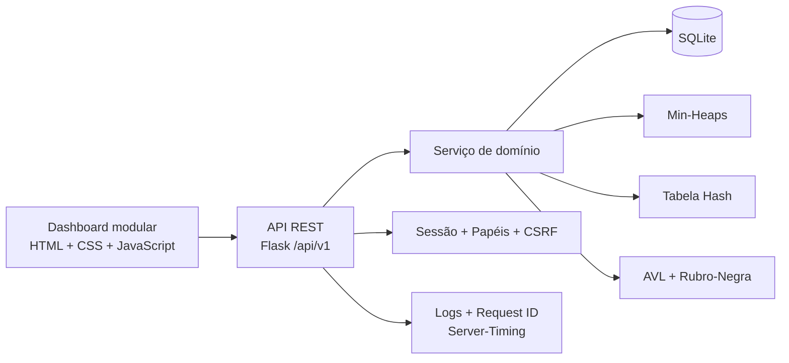

<div align="center">

# SIGAE

### Sistema Inteligente de Gerenciamento de Atendimentos de Emergência

**Plataforma full stack para triagem, priorização clínica, gestão de filas e distribuição inteligente da equipe médica.**

[](https://github.com/luiz-athayde87/Desenvolvimento-do-SIGAE/actions/workflows/ci.yml)
[](https://github.com/luiz-athayde87/Desenvolvimento-do-SIGAE/actions/workflows/e2e.yml)
[](https://github.com/luiz-athayde87/Desenvolvimento-do-SIGAE/actions/workflows/security.yml)


[Visão geral](#visão-geral) · [Funcionalidades](#funcionalidades) · [Estruturas de dados](#estruturas-de-dados) · [Como executar](#como-executar) · [Arquitetura](#arquitetura) · [Qualidade](#qualidade-e-segurança)

</div>

> [!IMPORTANT]
> O SIGAE é um projeto educacional e de portfólio. Ele não é um dispositivo médico e não deve ser utilizado para orientar decisões clínicas reais.

## Visão geral

O SIGAE simula o fluxo operacional de uma unidade de emergência em uma interface moderna, responsiva e organizada por contexto. Cada área possui uma rota independente, apresenta somente as informações necessárias à tarefa e consome o mesmo estado persistido pelo backend.

O sistema cobre o ciclo completo do atendimento: cadastro, triagem, priorização, entrada na fila, seleção do médico, atendimento, encerramento, histórico e auditoria. O relógio da interface e os registros operacionais utilizam tempo real — não há avanço de tempo simulado.

### O que torna o projeto diferente

| Pilar | Implementação |
|---|---|
| **Operação clara** | Páginas focadas para visão geral, pacientes, triagem, fila, médicos, histórico, relatórios e configurações |
| **Priorização inteligente** | Classificação P1–P5 com Min-Heap, desempate FIFO, reclassificação e identificação visual por cores clínicas |
| **Distribuição médica** | Seleção do profissional disponível com menor carga assistencial |
| **Dados consistentes** | SQLite como fonte persistente, transações e reconstrução segura dos índices em memória |
| **Rastreabilidade** | Histórico, trilha de auditoria, IDs de requisição e métricas de tempo de resposta |
| **Qualidade verificável** | Testes unitários, integração, jornadas E2E, cobertura mínima, CI e análise de segurança |

## Funcionalidades

### Experiência operacional

- dashboard com indicadores de fila, emergências, médicos disponíveis e atendimentos;
- cadastro, busca, filtros, paginação e acompanhamento de pacientes;
- seletor de prioridade P1–P5 com cores clínicas e atualização visual dinâmica no cadastro;
- triagem e reclassificação entre os níveis P1 e P5;
- chamada do próximo paciente conforme prioridade clínica e ordem de chegada;
- início, conclusão e cancelamento de atendimentos;
- gestão da disponibilidade e carga da equipe médica;
- histórico operacional e trilha de auditoria pesquisável;
- relatórios por prioridade e exportação em CSV;
- pesquisa global de pacientes, médicos e identificadores;
- relógio local em tempo real, timestamps UTC e atualização automática;
- interface responsiva para desktop, tablet e celular.

### Páginas do painel

| Rota | Área | Responsabilidade |
|---|---|---|
| `/` | Visão geral | Indicadores e panorama da unidade |
| `/patients` | Pacientes | Cadastro, pesquisa e acompanhamento |
| `/triage` | Triagem de risco | Classificação e reavaliação clínica |
| `/queue` | Fila de atendimento | Chamadas e atendimentos em andamento |
| `/doctors` | Corpo médico | Disponibilidade, carga e especialidades |
| `/history` | Histórico | Atendimentos e eventos auditáveis |
| `/reports` | Relatórios | Indicadores e exportações operacionais |
| `/structures` | Estruturas | Inspeção visual dos índices reais |
| `/settings` | Configurações | Acesso, segurança e dados da demonstração |

## Estruturas de dados

As estruturas são implementadas do zero em Python e reconstruídas a partir do estado persistido. A página **Estruturas** não exibe aproximações decorativas: ela representa a organização real usada pelo domínio.

| Estrutura | Uso no SIGAE | Complexidade esperada | Visualização canônica |
|---|---|---|---|
| **Min-Heap de pacientes** | Próximo atendimento por risco, chegada e ID | Topo `O(1)`; inserção/remoção `O(log n)` | Árvore binária completa com índices, raiz e relações E/D |
| **Min-Heap de médicos** | Profissional disponível com menor carga | Topo `O(1)`; inserção/remoção `O(log n)` | Árvore binária completa com carga e estado de cada médico |
| **Tabela Hash** | Localização eficiente de registros por identificador | Busca média `O(1)` | Todos os buckets, incluindo colisões em cadeias encadeadas |
| **Árvore AVL** | Índice balanceado do histórico | Busca/inserção `O(log n)` | Topologia real com altura e fator de balanceamento por nó |
| **Árvore Rubro-Negra** | Índice de pacientes aguardando por chegada e ID | Busca/inserção/remoção `O(log n)` | Topologia real com ligações pai-filho e cores dos nós |

```text
                    raiz
                  /      \
              filho E   filho D
              /   \       /   \
            ...   ...    ...   ...
```

Além da topologia, a interface identifica raiz, níveis, filhos esquerdo e direito, índices internos, fatores de balanceamento e estados relevantes. Estruturas vazias apresentam orientação contextual em vez de dados artificiais.

As estruturas obrigatórias não são substituídas por `dict`, `heapq`, `Map` ou bibliotecas de árvores. Os dicionários presentes nos registros representam apenas os campos das entidades; o mapa auxiliar `_indices` do heap de pacientes mantém a posição de cada ID para permitir reclassificação e remoção em `O(log n)`, sem realizar a ordenação da fila.

## Conformidade acadêmica

O fluxo operacional aciona as estruturas reais: cadastro insere nos índices, reclassificação reorganiza o Min-Heap, chamada extrai paciente e médico, saída da fila remove a chave da Rubro-Negra e conclusão devolve o médico atualizado ao heap de disponibilidade.

Os cenários exigidos para teste e defesa estão automatizados, incluindo:

- distribuição equilibrada entre três médicos e desempate determinístico;
- impedimento de reutilização de médico ocupado;
- ausência de médico disponível sem perda do paciente;
- prioridade clínica, FIFO e desempate por ID;
- reclassificação sem duplicidade;
- colisões e redimensionamento da Tabela Hash;
- inserções e remoções balanceadas na Rubro-Negra;
- conclusão e cancelamento sem registros órfãos ou contagem incorreta.

Consulte o [relatório de conformidade e roteiro de defesa](docs/avaliacao.md) para relacionar cada requisito do enunciado à implementação e à evidência automatizada.

## Como executar

### Pré-requisitos

- Python 3.11 ou superior;
- Git;
- Docker e Docker Compose, opcionalmente.

### Instalação local

```bash
git clone https://github.com/luiz-athayde87/Desenvolvimento-do-SIGAE.git
cd Desenvolvimento-do-SIGAE
python -m venv .venv
```

<details>
<summary><strong>Windows PowerShell</strong></summary>

```powershell
.\.venv\Scripts\Activate.ps1
python -m pip install -r requirements-dev.txt
python -m sigae.cli --dev
```

</details>

<details>
<summary><strong>Linux ou macOS</strong></summary>

```bash
source .venv/bin/activate
python -m pip install -r requirements-dev.txt
python -m sigae.cli --dev
```

</details>

Acesse **[http://127.0.0.1:5000](http://127.0.0.1:5000)**. O banco SQLite e os dados fictícios de demonstração são criados automaticamente em `instance/sigae.db`.

### Docker

Copie `.env.example` para `.env`, substitua a chave secreta e a senha por valores fortes e execute:

```bash
docker compose up --build
```

O contêiner utiliza usuário sem privilégios, autenticação obrigatória, volume persistente, servidor Waitress e healthcheck em `/api/v1/health`.

## Configuração

| Variável | Padrão local | Responsabilidade |
|---|---|---|
| `SIGAE_ENV` | `development` | Ambiente de execução |
| `SIGAE_SECRET_KEY` | chave local insegura | Assinatura da sessão; substitua em produção |
| `SIGAE_DATABASE` | `instance/sigae.db` | Caminho do banco SQLite |
| `SIGAE_AUTH_REQUIRED` | `false` | Ativação de autenticação, autorização e CSRF |
| `SIGAE_DEMO_USER` | `operador` | Administrador inicial |
| `SIGAE_DEMO_PASSWORD` | `sigae-demo` | Senha inicial; deve ser substituída |

Com autenticação ativa, faça login em `POST /api/v1/auth/login` e envie o token retornado no cabeçalho `X-CSRF-Token` das operações de escrita.

## Arquitetura



### Organização do repositório

```text
.
├── sigae/                 # aplicação, API, domínio, autenticação e persistência
├── templates/             # shell e páginas independentes do painel
├── static/                # design system e JavaScript modular por página
├── tests/                 # testes unitários, de API e integração
├── e2e/                   # jornadas críticas executadas no Chromium
├── docs/                  # arquitetura e contratos HTTP/OpenAPI
├── *.py                   # estruturas de dados implementadas do zero
├── Dockerfile             # imagem de produção
├── compose.yaml           # serviço e volume persistente
└── pyproject.toml         # dependências, lint, testes e cobertura
```

Para detalhes de implementação, consulte:

- [Arquitetura técnica](docs/architecture.md)
- [Documentação da API](docs/api.md)
- [Contrato OpenAPI](docs/openapi.yaml)
- [Guia de contribuição](CONTRIBUTING.md)
- [Política de segurança](SECURITY.md)
- [Histórico de versões](CHANGELOG.md)

## Qualidade e segurança

```bash
python -m ruff check .
python -m pytest --cov --cov-report=term-missing
python -m pip install -r requirements-e2e.txt
python -m playwright install chromium
python -m pytest e2e --browser chromium
```

O projeto possui atualmente **31 testes automatizados aprovados** e **89,32% de cobertura**, acima da exigência mínima de 85%.

Os workflows do GitHub executam:

- lint e verificação de qualidade Python;
- validação de sintaxe dos módulos JavaScript;
- testes em múltiplas versões do Python;
- jornadas reais no Chromium;
- análise estática com CodeQL;
- auditoria automática de dependências.

## Segurança e privacidade

Todos os registros incluídos no projeto são fictícios. Não utilize dados pessoais ou clínicos reais. Em ambientes compartilhados, habilite autenticação, utilize HTTPS no proxy reverso, altere todas as credenciais iniciais e restrinja o acesso ao banco e aos backups.

---

<div align="center">

Desenvolvido como projeto acadêmico de estruturas de dados, engenharia de software e experiência de usuário.

**[Voltar ao início](#sigae)**

</div>
