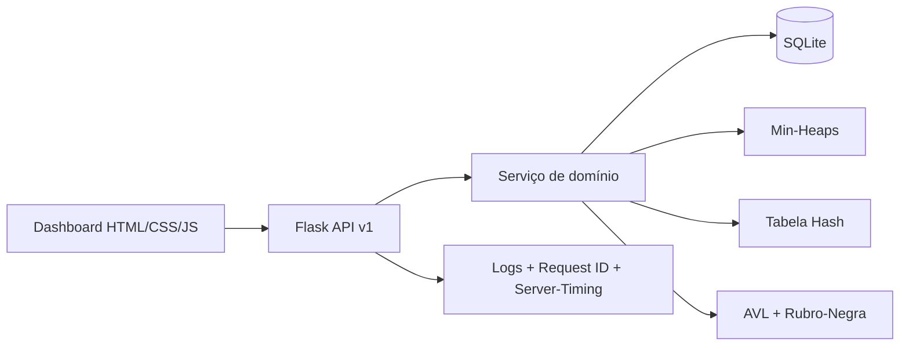

<div align="center">

# SIGAE

**Sistema Inteligente de Gerenciamento de Atendimentos de Emergência**

Simulador full stack de triagem, fila clínica, distribuição de médicos e auditoria de atendimentos.

[](https://github.com/luiz-athayde87/Desenvolvimento-do-SIGAE/actions/workflows/ci.yml)


</div>

> Projeto educacional e de portfólio. Não é um dispositivo médico e não deve orientar decisões clínicas reais.

## Visão geral

O SIGAE demonstra um fluxo hospitalar completo em uma interface responsiva: cadastro e reclassificação de pacientes, chamada por prioridade, balanceamento da carga médica, encerramento ou cancelamento do atendimento, pesquisa global, relatório CSV e inspeção visual das estruturas de dados.

O backend Flask é a fonte única de verdade. O estado operacional é persistido em SQLite, exposto por uma API REST versionada e reconstruído em estruturas de dados implementadas no próprio projeto.

### Destaques

- dashboard moderno, responsivo e acessível;
- classificação de risco P1–P5, com desempate FIFO;
- Min-Heaps de pacientes e médicos com operações `O(log n)`;
- Tabela Hash determinística, com encadeamento e redimensionamento;
- Árvore AVL e Árvore Rubro-Negra para o histórico;
- persistência SQLite, trilha de auditoria e transações;
- autenticação por sessão, papéis de acesso e proteção CSRF opcionais;
- cabeçalhos de segurança, IDs de requisição e `Server-Timing`;
- API `/api/v1`, exportação CSV e compatibilidade temporária com a API antiga;
- testes automatizados com cobertura mínima de 85%;
- CI, Docker, healthcheck e servidor Waitress para produção.

## Executar localmente

Requisitos: Python 3.11 ou superior e Git.

```bash
git clone https://github.com/luiz-athayde87/Desenvolvimento-do-SIGAE.git
cd Desenvolvimento-do-SIGAE
python -m venv .venv
```

No Windows PowerShell:

```powershell
.\.venv\Scripts\Activate.ps1
python -m pip install -r requirements-dev.txt
python -m sigae.cli --dev
```

No Linux ou macOS:

```bash
source .venv/bin/activate
python -m pip install -r requirements-dev.txt
python -m sigae.cli --dev
```

Acesse [http://127.0.0.1:5000](http://127.0.0.1:5000). O banco e os dados de demonstração são criados automaticamente em `instance/sigae.db`.

## Executar com Docker

Copie `.env.example` para `.env`, substitua a chave e a senha por valores fortes e execute:

```bash
docker compose up --build
```

O contêiner usa usuário sem privilégios, autenticação obrigatória, volume persistente e healthcheck em `/api/v1/health`.

## Configuração

| Variável | Padrão local | Uso |
|---|---|---|
| `SIGAE_ENV` | `development` | Define o ambiente; use `production` em produção |
| `SIGAE_SECRET_KEY` | chave insegura de desenvolvimento | Assina a sessão; deve ser longa e aleatória |
| `SIGAE_DATABASE` | `instance/sigae.db` | Caminho do banco SQLite |
| `SIGAE_AUTH_REQUIRED` | `false` | Ativa autenticação, autorização e CSRF |
| `SIGAE_DEMO_USER` | `operador` | Usuário administrador inicial |
| `SIGAE_DEMO_PASSWORD` | `sigae-demo` | Senha inicial; troque antes de publicar |

Com autenticação ativa, faça login em `POST /api/v1/auth/login` e envie o valor retornado em `X-CSRF-Token` nas operações de escrita.

## Arquitetura



Detalhes estão em [docs/architecture.md](docs/architecture.md), e o contrato HTTP em [docs/api.md](docs/api.md) e [docs/openapi.yaml](docs/openapi.yaml).

## Qualidade

```bash
python -m ruff check .
python -m pytest --cov --cov-report=term-missing
```

A automação em `.github/workflows/ci.yml` executa lint e testes em três versões do Python. Consulte [CONTRIBUTING.md](CONTRIBUTING.md) antes de contribuir e [SECURITY.md](SECURITY.md) para reportar vulnerabilidades.

## Estrutura principal

```text
.
├── sigae/                 # aplicação, API, domínio, autenticação e persistência
├── templates/             # dashboard web
├── tests/                 # testes de API, domínio e estruturas
├── docs/                  # arquitetura e contrato HTTP
├── *.py                   # estruturas de dados implementadas do zero
├── Dockerfile             # imagem de produção
├── compose.yaml           # serviço e volume persistente
└── pyproject.toml         # metadados, lint, testes e cobertura
```

## Segurança e privacidade

Os dados incluídos são fictícios. Não armazene dados pessoais ou clínicos reais neste simulador. Para qualquer ambiente compartilhado, ative autenticação, use HTTPS no proxy reverso, troque todas as credenciais e restrinja o acesso ao banco e aos backups.

O histórico de evolução está no [CHANGELOG.md](CHANGELOG.md).
